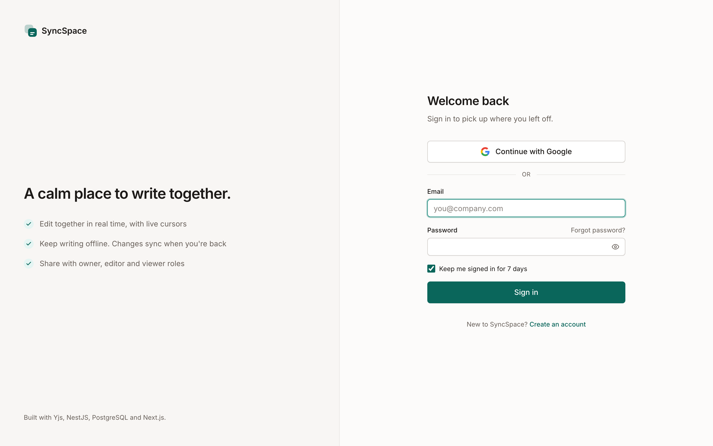
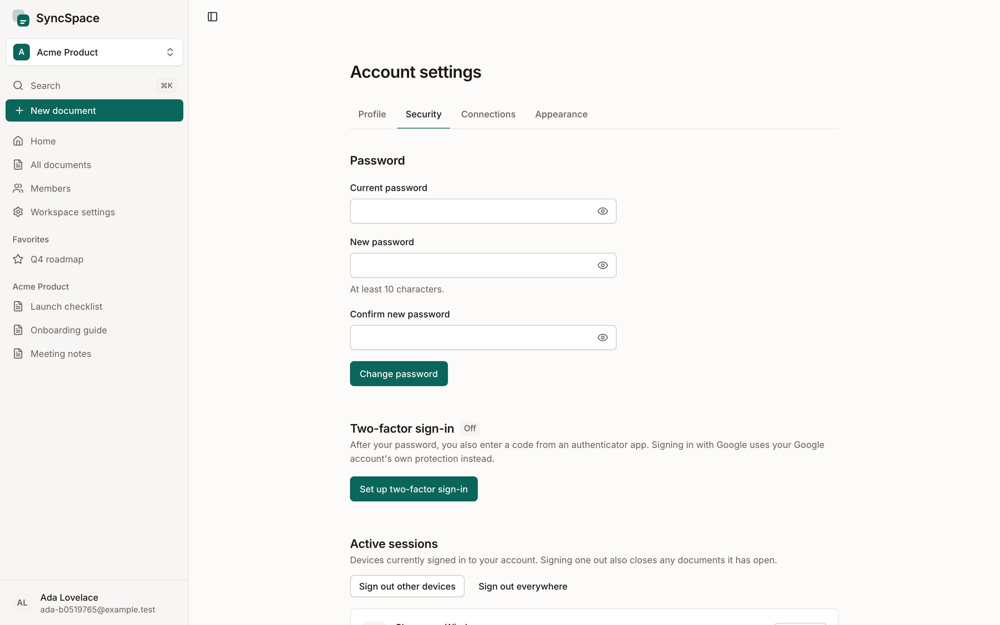
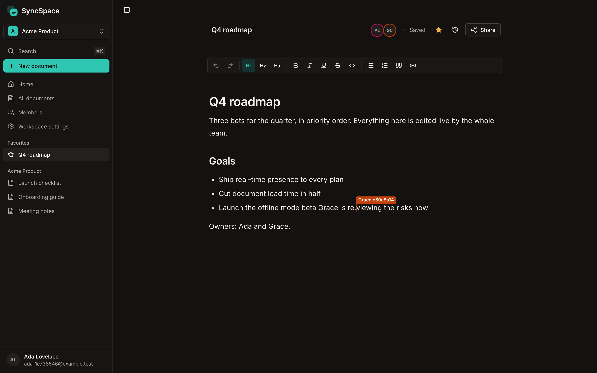
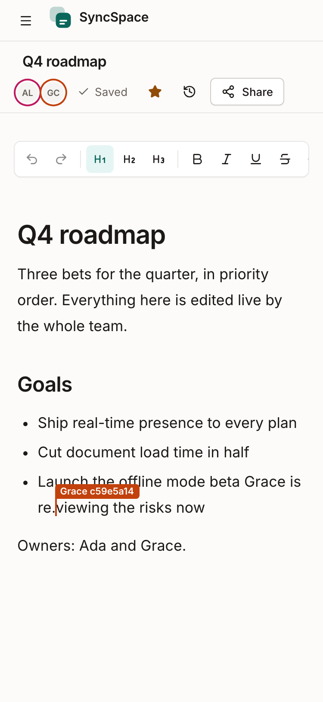
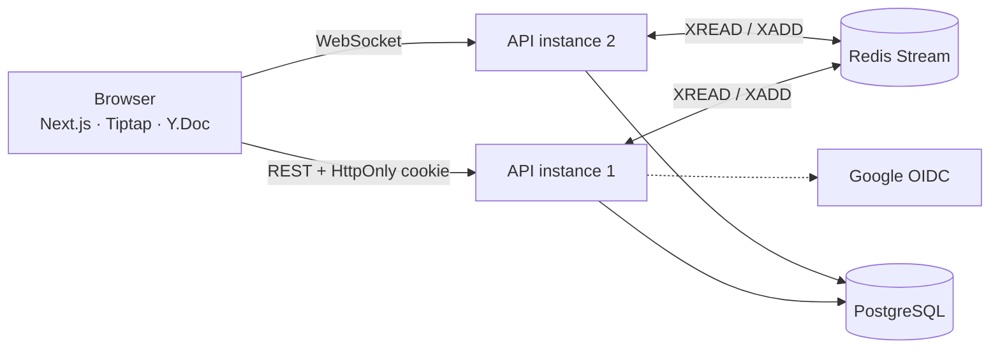

# SyncSpace

[](https://github.com/sushildalavi/SyncSpace/actions/workflows/ci.yml)

**Real-time collaborative documents with offline editing, live cursors, role-based sharing and secure sign-in.**
Full-stack TypeScript: Next.js · NestJS · PostgreSQL · Yjs · Redis · Better Auth.


## Highlights

| | |
| --- | --- |
| **Live collaboration** | Several people edit one document, with cursors and presence, across multiple API instances |
| **Offline first** | Edits made offline are kept in the browser and sync on reconnect. *Saved* appears only after the database has the edit |
| **Permissions** | Owner, editor and viewer roles, checked on every write. A single document can be shared with someone outside the workspace |
| **Accounts** | Email and Google sign-in, two-factor codes, session revocation, email change, account deletion |
| **Tested under failure** | No acknowledged edit lost through Redis, database and instance failures, including 90 s outages ([details](docs/performance.md#failure-testing)) |
| **Measured** | 280 clients on two instances on one laptop: 0 divergence, 95% of saves within about 80 ms ([details](docs/performance.md#speed)) |

## Features

- **Rich-text editor** (Tiptap on Yjs): headings, formatting, lists, quotes, code, links and keyboard shortcuts.
- **Workspaces** with invitations by email, live role changes and last-owner protection. Removing access closes open documents at once.
- **Version history** with previews and one-click restore. A restore is a new version, so it can be undone.
- **Finding things**: favorites, recent documents, search and a ⌘K command menu.
- **Security**: Argon2id passwords, database-backed sessions, explicit-only Google account linking, security activity log.
- **Interface**: light and dark themes, responsive down to 320 px, automated WCAG 2.2 AA checks.

<table>
<tr>
<td width="50%"></td>
<td width="50%"></td>
</tr>
<tr>
<td></td>
<td></td>
</tr>
<tr>
<td></td>
<td></td>
</tr>
</table>

More: [command menu](docs/screenshots/commandMenuLight.png) · [members](docs/screenshots/membersLight.png) · [version history](docs/screenshots/historyLight.png) · [connections](docs/screenshots/connectionsLight.png) · [account](docs/screenshots/accountLight.png) · [mobile navigation](docs/screenshots/mobileNavigation.png)

## Quick start

Requires Docker.

```bash
git clone https://github.com/sushildalavi/SyncSpace.git && cd SyncSpace
docker compose up -d --build
```

| URL | What |
| --- | --- |
| <http://localhost:3000> | The app |
| <http://localhost:8025> | **Mailpit**: every email (confirmation, reset, invitations) lands here |
| <http://localhost:3001/health> | API health (PostgreSQL and Redis) |

Compose uses a development-only `BETTER_AUTH_SECRET`. Set your own in `.env` for anything shared. Google sign-in stays hidden until you add credentials ([setup guide](docs/googleSignIn.md)). To run on your own server with HTTPS, follow the [deployment guide](docs/deployment.md).

### Local development

```bash
cp .env.example .env
docker compose up -d postgres redis mailpit
corepack enable && pnpm install        # or: npx pnpm@10.15.1 install
pnpm --filter @syncspace/api dev       # API on :3001, runs migrations on start
pnpm --filter @syncspace/web dev       # web on :3000
```

## Demo walkthrough

1. Open <http://localhost:3000/sign-up> and create **Ada**. Confirm the email in Mailpit, then sign in.
2. Name a workspace, click **New document** and type.
3. In a private window, create **Grace** the same way.
4. As Ada, use **Share → Invite people** to invite Grace as *Editor*. As Grace, accept from the Mailpit link.
5. Both open the document and type: edits and cursors appear live.
6. In Grace's browser tools, go *Offline*, keep typing, then reconnect and watch both windows match.
7. As Ada, make Grace a *Viewer*: Grace's editor becomes read-only without a reload.

## Architecture



Good places to read the code: [live editing on the server](apps/api/src/collaboration/collaboration.service.ts), [offline queue and resending](apps/web/src/lib/collab/provider.ts), [permissions](apps/api/src/access/access.service.ts).

## Documentation

| Guide | Contents |
| --- | --- |
| [Architecture](docs/architecture.md) | How an edit travels, data model, failure behaviour, design decisions |
| [API](docs/api.md) | REST routes and the collaboration WebSocket |
| [Testing](docs/testing.md) | Test suites and accessibility |
| [Performance](docs/performance.md) | Speed and failure testing |
| [Deployment](docs/deployment.md) | Single-server setup, backups and restores |
| [Google sign-in](docs/googleSignIn.md) | Setup and what has been verified |
| [Migration](docs/migration.md) | Moving data from the earlier MongoDB version |

## Repository layout

```
apps/
  api/            NestJS API: auth, access, documents, collaboration, database
  web/            Next.js app
    src/components/   account, auth, document, editor, layout, ui, workspace
    src/hooks/        shared React hooks
    src/lib/          API client, auth client, collaboration client
  loadtest/       load and failure test programs
packages/
  contracts/      request schemas and the permission rules shared by API and web
  config/         environment validation
e2e/              browser tests
infrastructure/   Dockerfiles and the production stack
scripts/          benchmark, failure test and deployment check
docs/             guides and screenshots
```

File and folder names use camelCase. Exceptions are names that a tool or the web address depends on, such as `not-found.tsx`, `docker-compose.yml`, route folders like `sign-in`, and database migrations.

## Testing

```bash
pnpm lint && pnpm typecheck && pnpm test      # unit and integration (in-process PostgreSQL)
docker compose up -d postgres redis mailpit
docker compose exec postgres psql -U syncspace -d postgres -c "create database syncspace_test"
pnpm test:e2e                                  # real browsers against the real stack
scripts/bench.sh                               # load test
scripts/faultInjection.sh                      # break Redis, PostgreSQL or an instance under load
```

GitHub Actions runs lint, type checks, tests, builds, the browser suite and Docker image builds.

## Limitations

- **No hosted demo.** The [single-server setup](docs/deployment.md) has been rehearsed locally, not on a public server.
- **Google sign-in has been checked locally only**, with one test user ([details](docs/googleSignIn.md#4-what-is-and-isnt-verified)).
- **Failure and speed tests ran on one machine.** Network splits, database failover and outages over 90 s are untested.
- **No screen-reader testing** ([details](docs/testing.md#accessibility)).
- No public share links: a shared document needs a confirmed account with that email address.
- Two-factor sign-in covers password sign-in. Google sign-in relies on the Google account's own protection.
- Users migrated from the earlier version are imported as unconfirmed.
