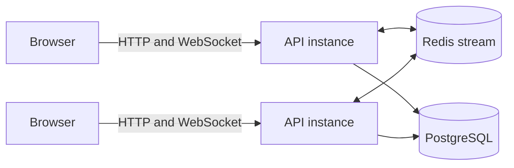

# SyncSpace

[](https://github.com/sushildalavi/SyncSpace/actions/workflows/ci.yml)

A collaborative rich-text editor. Several people can write in the same document at once, keep typing through a lost
connection, and control who can read or edit. It is a TypeScript monorepo: a Next.js web app and a NestJS API, with
PostgreSQL for storage, Redis for passing events between API instances, and Yjs for merging concurrent edits.


## Features

- Real-time editing with remote cursors, presence and a formatting toolbar
- Edits made while disconnected are queued in the browser and replayed on reconnect
- Version history with restore, which adds a new version and leaves history intact
- Workspaces with owner, editor and viewer roles, email invitations, and sharing of a single document with someone
  outside the workspace
- Email and password or Google sign-in, authenticator-app two-factor codes, session management, email change and account
  deletion
- Light and dark themes, a command menu, and a layout that works on phones

More screens are in [docs/screenshots](docs/screenshots).

## How it works



Each browser holds a Yjs copy of the document and sends incremental updates, batched over about 50 ms. For every update
the API:

1. re-reads the sender's role from PostgreSQL, so a viewer or a removed member can't write through an open socket;
2. in one transaction, increments the document's version counter and appends the update. Versions are assigned by the
   server, and a client-chosen update id makes retries idempotent;
3. acknowledges the sender (only then does the editor show "Saved"), forwards the update to its own sockets and appends
   it to a Redis stream that every instance reads.

PostgreSQL is the source of truth and the Redis stream is allowed to lose events. Every 10 seconds each instance tells
its clients the latest persisted version, and a client that has a gap asks for the document state again. A snapshot every
50 updates keeps loading from replaying the whole log. Role changes, removals and revoked sessions are pushed to open
sockets, with a periodic database check as a fallback.

[Architecture](docs/architecture.md) covers the data model, failure behaviour and design decisions.

## Run it

You need Docker with the Compose plugin.

```bash
git clone https://github.com/sushildalavi/SyncSpace.git
cd SyncSpace
docker compose up -d --build
```

Open <http://localhost:3000> and create an account. The app sends its email, including the confirmation link, to a local
test inbox at <http://localhost:8025>.

This Compose file is for local use. Its default auth secret is in the repository, and ports 3000 and 3001 listen on all
network interfaces. For a server, follow [Deployment](docs/deployment.md). Google sign-in is optional and set up with the
[Google guide](docs/googleSignIn.md).

## Development

CI uses Node.js 22. The pnpm version is pinned in `package.json`.

```bash
cp .env.example .env
docker compose up -d postgres redis mailpit
corepack enable && pnpm install

# The apps read environment variables and don't load .env themselves.
set -a && . ./.env && set +a
pnpm --filter @syncspace/api dev    # http://localhost:3001, applies migrations on start
```

In a second terminal:

```bash
pnpm --filter @syncspace/web dev    # http://localhost:3000
```

If you started the whole stack earlier, run `docker compose stop api web` first so the ports are free.

### Configuration

[.env.example](.env.example) has development values. The API validates its environment at startup
([packages/config](packages/config/src/index.ts)).

| Variable | Default | Notes |
| --- | --- | --- |
| `DATABASE_URL`, `REDIS_URL` | required | PostgreSQL and Redis connection URLs |
| `BETTER_AUTH_SECRET` | required | At least 32 characters. The placeholder values in this repository are refused in production |
| `API_BASE_URL` | `http://localhost:3001` | Public origin of the API, used for OAuth callbacks |
| `WEB_ORIGIN` | `http://localhost:3000` | The only origin allowed to make changes or open sockets |
| `API_PORT` | `3001` | Port the API listens on |
| `NEXT_PUBLIC_API_BASE_URL` | `http://localhost:3001` | Read by the web app and compiled in when it is built |
| `SMTP_URL`, `MAIL_FROM` | unset, a local address | Without `SMTP_URL`, emails are written to the log outside production and dropped in production |
| `REQUIRE_EMAIL_VERIFICATION` | `false` | Both Compose files set `true` |
| `GOOGLE_CLIENT_ID`, `GOOGLE_CLIENT_SECRET` | unset | Set both or neither |
| `TRUST_PROXY` | `0` | Number of reverse proxies in front of the API; decides which client address is rate limited |
| `SESSION_TTL_DAYS` | `7` | Session lifetime |
| `RUN_MIGRATIONS` | `true` | Apply database migrations when the API starts |
| `LEGACY_MONGO_URL` | unset | Only for the [MongoDB migration](docs/migration.md) |

## Testing

```bash
pnpm lint
pnpm typecheck
pnpm test        # unit and integration tests; no services needed
```

API tests run against an in-process PostgreSQL (PGlite) with the real migrations. The browser tests need the Compose
services, a test database and Chromium:

```bash
docker compose up -d postgres redis mailpit
docker compose exec postgres psql -U syncspace -d postgres -c "create database syncspace_test"   # once
pnpm exec playwright install chromium                                                            # once
pnpm test:e2e
```

They build and start the apps themselves on ports 3100 and 3101, with a local stand-in for Google on 3199. CI runs lint,
type checks, tests, the build, the browser tests and both Docker image builds. See [Testing](docs/testing.md) for what is
covered, including the accessibility checks and what has not been checked.

## Load and failure tests

`scripts/bench.sh` runs two API instances against one database and reports latency and whether every client converged.
`scripts/faultInjection.sh` pauses, kills and stops Redis, PostgreSQL and an API instance while clients keep editing,
then checks that no acknowledged update is missing and all clients match the stored document. Commands, recorded results
and the limits of those results are in [Performance and failure testing](docs/performance.md).

## Limitations

- A document must be loaded while online. Unsent edits survive a reload, but there is no service worker or local copy of
  documents, so the app can't open one without a connection.
- The web app has no control for deleting a document; the API does.
- Slack and Teams webhooks can be saved in workspace settings, but nothing in the web app sends to them yet. Sending is
  available only through the API.
- The update log is never pruned, so storage grows with every edit. The history page lists the latest 200 updates.
- Search matches document titles, not their contents.
- Authentication routes, account deletion and collaboration socket messages are rate limited. Invitation and sharing
  emails are not.
- Two-factor codes apply to password sign-in, not Google sign-in.
- The production setup is a single server with one API instance. It has been rehearsed locally, not on a public server.
- No screen-reader testing has been done.

## Project layout

```
apps/api         NestJS API, database schema and migrations
apps/web         Next.js app
apps/loadtest    load and fault-injection clients
packages         shared contracts (roles, request schemas, protocol limits) and environment parsing
e2e              Playwright browser tests
infrastructure   Dockerfiles and the production Compose and Caddy setup
scripts          load test, fault injection and deployment check
docs             guides and screenshots
```

## Documentation

- [Architecture](docs/architecture.md)
- [API](docs/api.md)
- [Testing and accessibility](docs/testing.md)
- [Performance and failure testing](docs/performance.md)
- [Deployment](docs/deployment.md)
- [Google sign-in](docs/googleSignIn.md)
- [Migrating from the MongoDB version](docs/migration.md)

## License

[MIT](LICENSE)
