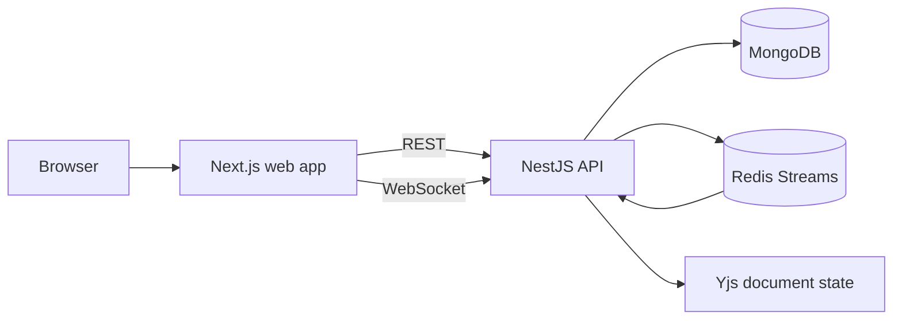
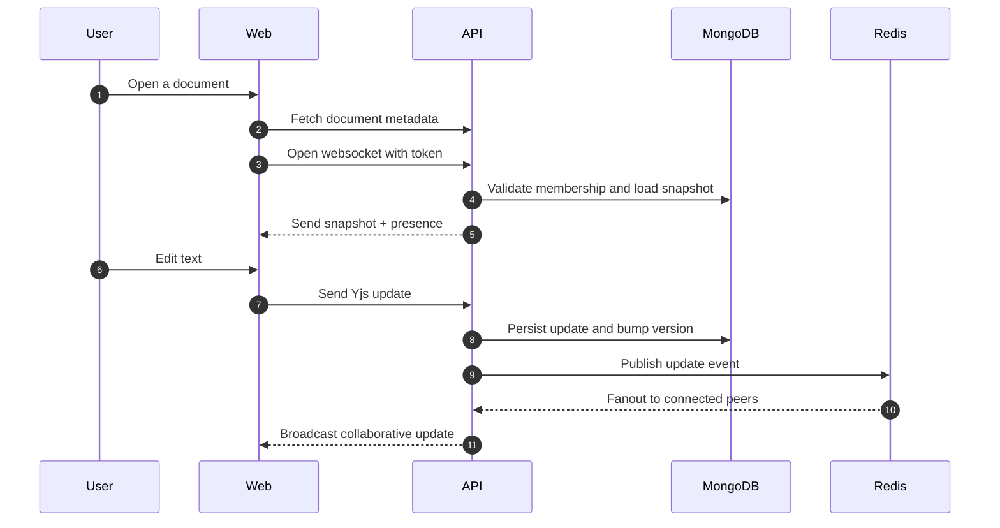

# SyncSpace

SyncSpace is a production-oriented collaborative workspace for real-time document editing, workspace membership, and versioned history. It uses Next.js for the web app, NestJS for the API and collaboration gateway, MongoDB for persistence, Redis Streams for cross-instance fanout, and Yjs for conflict-free document synchronization.

## What it ships

- authenticated workspaces and membership-based access control
- live collaborative editing with websocket transport
- offline-friendly client state and queued updates
- document history and version snapshots
- shared contracts across web, API, and sync packages
- end-to-end verification with unit, integration, and browser coverage

## System overview



## Collaboration lifecycle



## Repository layout

```text
apps/
  api/        NestJS REST + websocket gateway
  web/        Next.js client
  loadtest/   Collaboration load harness
packages/
  collaboration/ CRDT helpers and policy
  config/         shared env parsing
  contracts/      shared zod contracts
docs/         architecture, API, benchmarks, failure modes
infrastructure/ Dockerfiles for web and api
```

## Local development

### Prerequisites

- Node.js 20+
- pnpm 10+
- Docker Desktop
- MongoDB and Redis, or `docker compose`

### Start the stack

```bash
cp .env.example .env
pnpm install
docker compose up -d
pnpm dev
```

### Useful commands

```bash
pnpm lint
pnpm typecheck
pnpm test
pnpm test:e2e
pnpm build
```

## Quality gates

The repository is wired for a full verification pass:

- linting with a shared ESLint config
- TypeScript typechecking across the workspace
- API service tests
- browser coverage for the collaborative editor flow
- documented architecture and failure modes

## Environment

Copy `.env.example` to `.env` and provide the values for:

- `DATABASE_URL`
- `REDIS_URL`
- `JWT_SECRET`
- `JWT_EXPIRES_IN`
- `NEXT_PUBLIC_API_BASE_URL`

## Production notes

- The API owns authentication and membership checks.
- Collaboration updates are normalized server-side before persistence.
- Redis Streams is used so multiple API instances can coordinate the same document.
- The web client is designed to survive reconnects and offline pauses without dropping local edits.

## Documentation

- [Architecture overview](docs/architecture/overview.md)
- [MongoDB data model](docs/data-model/mongodb.md)
- [REST API](docs/api/rest.md)
- [WebSocket protocol](docs/api/websockets.md)
- [Failure modes](docs/failure-modes.md)
- [Testing guide](docs/testing.md)
- [Benchmark methodology](docs/benchmarks/methodology.md)
- [ADR: Yjs collaboration](docs/adr/0001-yjs-collaboration.md)

