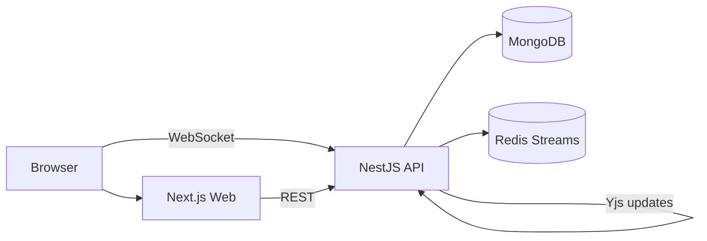

# SyncSpace

SyncSpace is a real-time collaborative workspace built with Next.js, NestJS, MongoDB, Redis Streams, and Yjs.

## Local development

1. Copy `.env.example` to `.env` and adjust values if needed.
2. Install dependencies with `pnpm install`.
3. Start the backing services and apps with `docker compose up` or run the apps locally through `pnpm dev`.

## Architecture

## Modules

- `apps/web`: user-facing application
- `apps/api`: backend API and collaboration gateway
- `apps/loadtest`: collaboration load harness
- `packages/contracts`: shared typed contracts
- `packages/collaboration`: CRDT and sync utilities
- `packages/config`: shared config helpers
