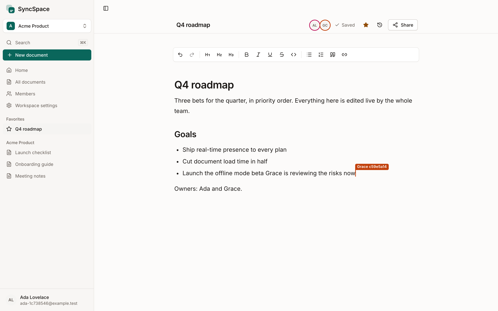
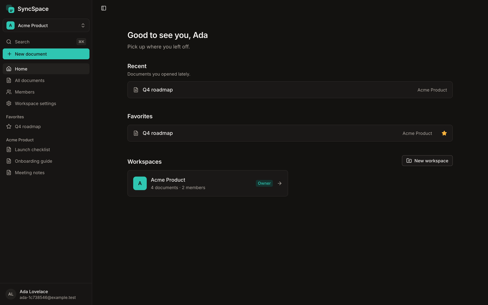
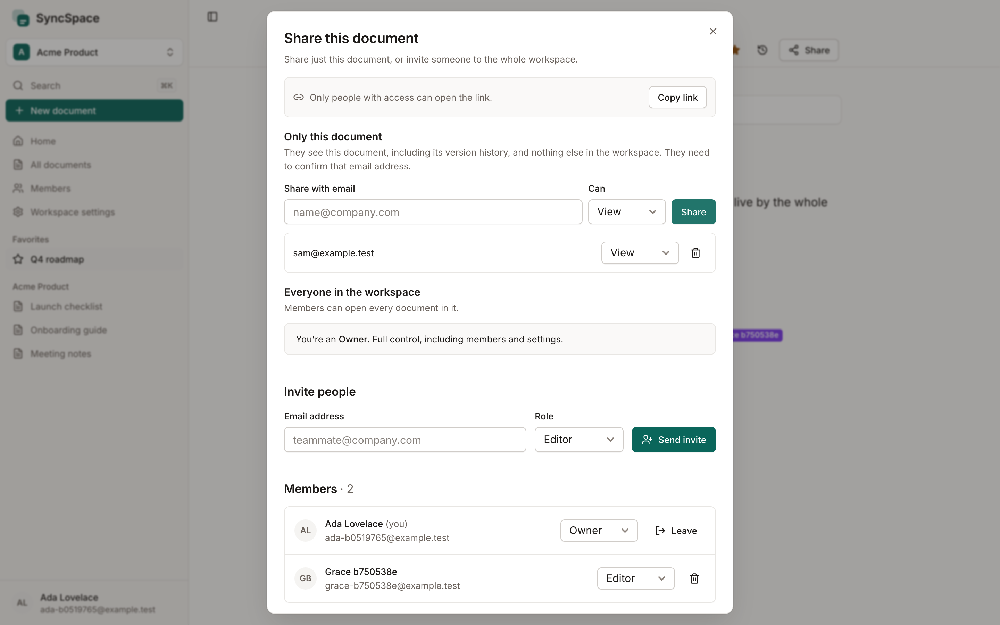
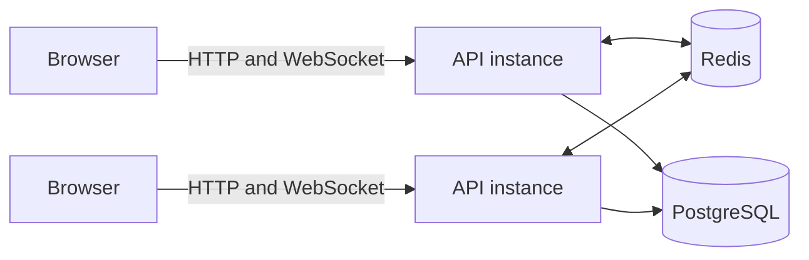

# SyncSpace

[](https://github.com/sushildalavi/SyncSpace/actions/workflows/ci.yml)

A collaborative document editor. Several people can write in the same document at once, keep working when they lose their connection, and control who can read or edit.

Built with TypeScript, Next.js, NestJS, PostgreSQL, Redis and Yjs.



## Features

- Real-time editing with live cursors and a rich-text toolbar
- Offline editing that syncs when you reconnect
- Workspaces with owner, editor and viewer roles
- Sharing a single document with someone outside the workspace
- Version history with restore
- Email and Google sign-in, two-factor codes and session management
- Light and dark themes, and a layout that works on phones

<table>
<tr>
<td width="50%"></td>
<td width="50%"></td>
</tr>
</table>

More in [docs/screenshots](docs/screenshots).

## Running it

You need Docker.

```bash
git clone https://github.com/sushildalavi/SyncSpace.git
cd SyncSpace
docker compose up -d --build
```

Open <http://localhost:3000> and create an account. Emails sent by the app, including the confirmation link, show up at <http://localhost:8025>.

Google sign-in is optional. To turn it on, follow the [setup guide](docs/googleSignIn.md).

## Development

```bash
cp .env.example .env
docker compose up -d postgres redis mailpit
corepack enable && pnpm install
pnpm --filter @syncspace/api dev    # http://localhost:3001
pnpm --filter @syncspace/web dev    # http://localhost:3000
```

Run the checks with:

```bash
pnpm lint
pnpm typecheck
pnpm test
```

The browser tests need their own database the first time:

```bash
docker compose exec postgres psql -U syncspace -d postgres -c "create database syncspace_test"
pnpm test:e2e
```

## How it works

Each browser keeps its own copy of the document and sends only what changed. The server checks that the person is allowed to edit, saves the change to PostgreSQL and then confirms it. Redis passes the change to other API instances, and Yjs merges edits made at the same time.



## Project layout

```
apps/api         NestJS API
apps/web         Next.js app
apps/loadtest    load and failure tests
packages         code shared between the apps
e2e              browser tests
infrastructure   Dockerfiles and production setup
scripts          helper scripts
docs             guides and screenshots
```

## Documentation

- [Architecture](docs/architecture.md)
- [API](docs/api.md)
- [Testing](docs/testing.md)
- [Performance](docs/performance.md)
- [Deployment](docs/deployment.md)
- [Google sign-in](docs/googleSignIn.md)
- [Migrating from the MongoDB version](docs/migration.md)

## License

[MIT](LICENSE)
