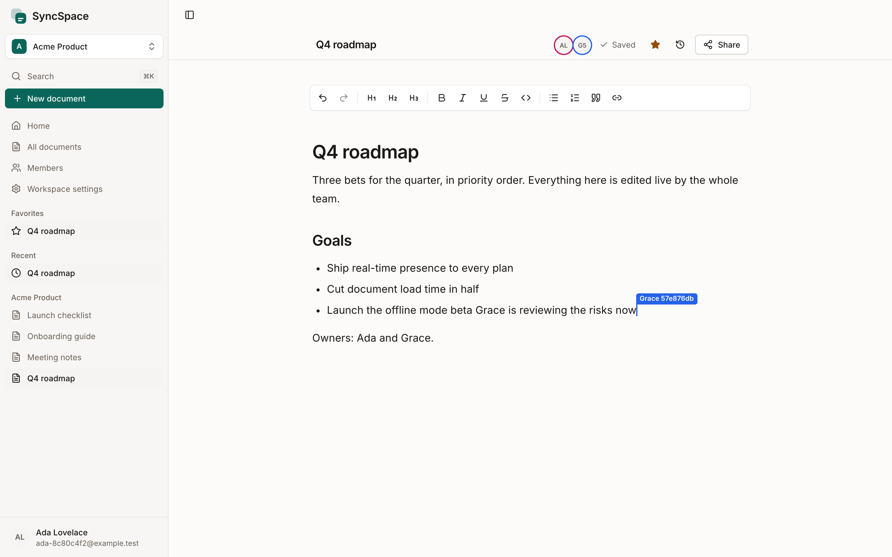
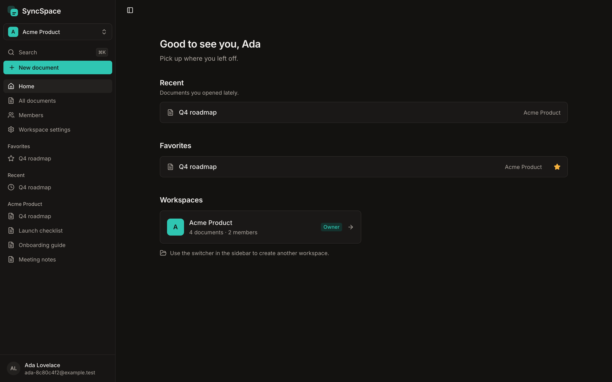
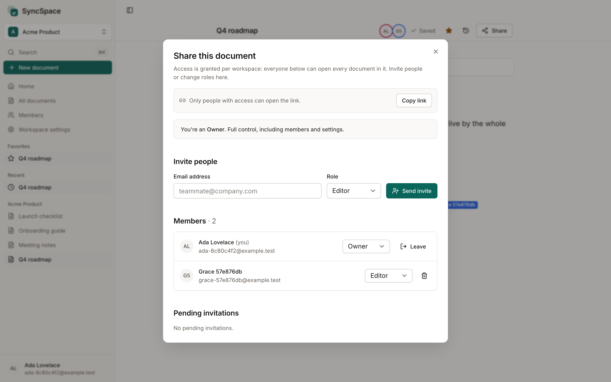
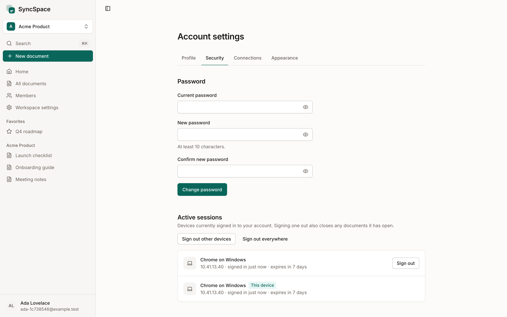
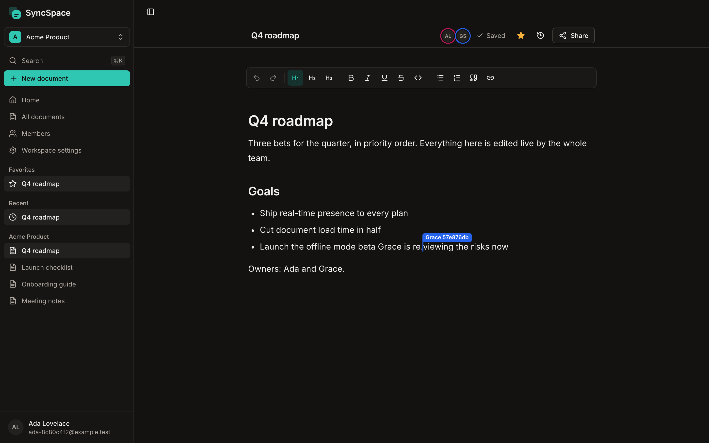
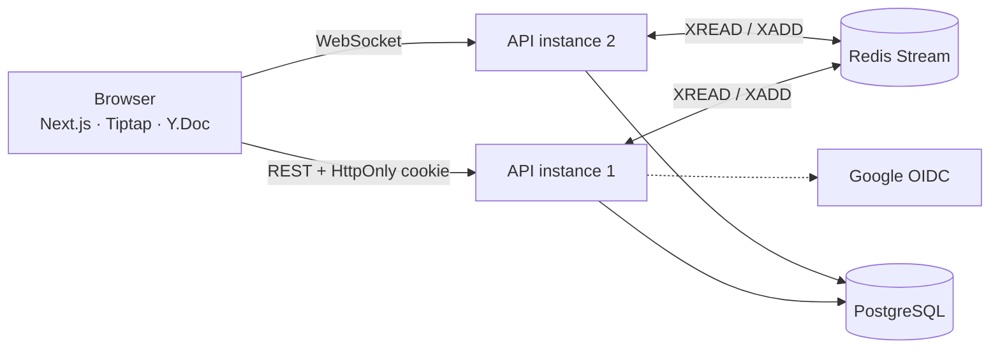

# SyncSpace

**Real-time collaborative documents with offline editing, live cursors, role-based sharing and secure sign-in (email and Google).**
Full-stack TypeScript: Next.js · NestJS · PostgreSQL · Yjs · Redis · Better Auth.



## What to look at first

| If you have 2 minutes | Where |
| --- | --- |
| Watch two browsers edit one document | [Demo walkthrough](#demo-walkthrough) |
| See how permissions are enforced on live sockets | [`collaboration.service.ts`](apps/api/src/collaboration/collaboration.service.ts) · [tests](apps/api/test/collaboration.service.spec.ts) |
| See how multi-server delivery works | [Architecture](docs/architecture/overview.md) · [ADR 0004](docs/adr/0004-stream-fanout.md) |
| Numbers | [Benchmark](docs/benchmarks/collaboration.md): 280 clients on two API instances, 4,000 updates, 0 divergence, p95 ack ≈ 64 ms. [Fault injection](docs/benchmarks/fault-injection.md): survives Redis loss and a crash |
| What was wrong before, and what changed | [Baseline and outcome](docs/modernization/baseline.md) |

## Features

- **Collaborative rich-text editor** (Tiptap on Yjs): headings, bold/italic/underline/strike, lists, quotes, code, links, keyboard shortcuts, remote cursors with names, presence avatars.
- **Honest sync state**: *Saved* appears only after the server acknowledged persistence. *Offline*, *Reconnecting* and *View only* are real connection and role states.
- **Offline-first**: edits made offline are queued in IndexedDB, survive a reload, and replay idempotently on reconnect.
- **Workspaces and roles** (Owner / Editor / Viewer) with invitations by email, live role changes and last-owner protection. Removing a member or revoking a session closes their open documents immediately.
- **Version history** with read-only previews of any past version and **one-click restore**. A restore is saved as a new version, so it can itself be undone. **Favorites, recents, search and a ⌘K command menu.**
- **Account security**: Argon2id passwords, email verification, password reset, database-backed sessions with a per-device list and revocation, **Google sign-in** with explicit-only account linking, security activity log.
- **Design system**: light and dark themes, tokenised colour/type/radius/shadow/motion/focus, responsive down to 375 px, axe-scanned against WCAG 2.2 AA rules, reduced-motion support.

<table>
<tr>
<td width="50%"></td>
<td width="50%"></td>
</tr>
<tr>
<td></td>
<td></td>
</tr>
<tr>
<td></td>
<td></td>
</tr>
</table>

More: [command menu](docs/screenshots/command-menu-light.png) · [members](docs/screenshots/members-light.png) · [version history](docs/screenshots/history-light.png) · [connections](docs/screenshots/connections-light.png) · [mobile navigation](docs/screenshots/mobile-navigation.png)

## Quick start

Requires Docker.

```bash
git clone https://github.com/sushildalavi/SyncSpace.git && cd SyncSpace
docker compose up -d --build
```

| URL | What |
| --- | --- |
| <http://localhost:3000> | The app |
| <http://localhost:8025> | **Mailpit**: every email (verification, reset, invitations) lands here |
| <http://localhost:3001/health> | API health (PostgreSQL + Redis) |

Compose uses a development-only `BETTER_AUTH_SECRET`. Set your own in `.env` for anything shared. Google sign-in is hidden until you add credentials ([setup guide](docs/auth/google-setup.md)).

### Local development

```bash
cp .env.example .env
docker compose up -d postgres redis mailpit
corepack enable && pnpm install        # or: npx pnpm@10.15.1 install
pnpm --filter @syncspace/api dev       # API on :3001, runs migrations on start
pnpm --filter @syncspace/web dev       # web on :3000
```

To run it on your own server with HTTPS, follow the [deployment guide](docs/deployment.md).

## Demo walkthrough

1. Open <http://localhost:3000/sign-up> and create **Ada**. Open Mailpit and click the confirmation link, then sign in.
2. Name a workspace. Click **New document** and type; use the toolbar or `⌘B`, `⌘⌥1`, `- ` for a list.
3. In a **private window**, create **Grace** (confirm via Mailpit).
4. As Ada: **Share → Invite** Grace's email as *Editor*. As Grace, open the invitation link from Mailpit and accept.
5. Both open the document. Type in each window: edits and cursors with names appear live, with avatars at the top.
6. **Offline**: in Grace's DevTools → Network, tick *Offline*. The status chip changes to *Offline*; keep typing. Untick it and watch both windows converge.
7. **Permissions**: as Ada open **Members** and set Grace to *Viewer*. Grace's editor becomes read-only *without a reload*. Remove Grace and her tab shows "access removed".
8. **Sessions**: Settings → Security lists devices. *Sign out other devices* ends Grace's live connection.

## Architecture



Details, sequence of a write, and failure behaviour: [docs/architecture/overview.md](docs/architecture/overview.md), [data model](docs/data-model/postgres.md), [REST](docs/api/rest.md), [WebSocket protocol](docs/api/websockets.md), [failure modes](docs/failure-modes.md), [ADRs](docs/adr).

## Repository layout

```
apps/api         NestJS API, Better Auth, collaboration gateway, Drizzle schema + migrations
apps/web         Next.js app, design system (src/components/ui), editor (src/components/editor)
apps/loadtest    Collaboration load generator
packages/contracts   Zod schemas + the RBAC permission matrix shared by API and web
packages/config      Environment validation
e2e/             Playwright suite (+ a protocol-level Google mock)
infrastructure/  Dockerfiles and the single-server production stack
docs/            Architecture, ADRs, runbooks, benchmarks, screenshots
```

## Testing

```bash
pnpm lint && pnpm typecheck && pnpm test      # unit/integration (in-process PostgreSQL)
docker compose up -d postgres redis mailpit
docker compose exec postgres psql -U syncspace -d postgres -c "create database syncspace_test"
pnpm test:e2e                                  # real browsers against the real stack
scripts/bench.sh                               # multi-instance load test
scripts/fault-injection.sh                     # Redis pause/flush, frozen instance, kill -9 under load
```

See [docs/testing.md](docs/testing.md). GitHub Actions runs lint, typecheck, unit tests, build, the full Playwright suite and Docker image builds.

## Migrating from the MongoDB version

[docs/modernization/migration.md](docs/modernization/migration.md): a read-only, repeatable, verified migrator with a dry-run mode and a rollback plan.

## Limitations

Stated plainly:

- **Live Google sign-in has been checked locally only** (2026-11-25, one test user, consent screen in *Testing*): sign-in, sign-out and sign-in again to the same account. A public domain, a published consent screen and live account linking from Settings are untested. The other OAuth paths are covered against a local OIDC stand-in. [Details](docs/auth/google-setup.md#4-what-is-and-isnt-verified).
- **No hosted demo.** There is no public deployment, so run it locally (two commands above). The [single-server setup](docs/deployment.md) has been rehearsed locally but not on a public server.
- **Fault injection is one scenario on one machine** (Redis pause and flush, a frozen instance, `kill -9`). It found and fixed three real defects, and its limits are listed in [docs/benchmarks/fault-injection.md](docs/benchmarks/fault-injection.md#limits-of-this-test). PostgreSQL failure and long outages are untested.
- Sharing is per workspace, not per document. There are no public share links.
- Email change, account deletion and two-factor authentication are not implemented.
- Accessibility is checked with axe's WCAG 2.2 AA rules plus keyboard tests. Automated tools cover only part of the criteria, and there has been no screen-reader or manual audit.
- Migrated legacy users are imported as unverified and need to confirm their email if verification is enforced.
