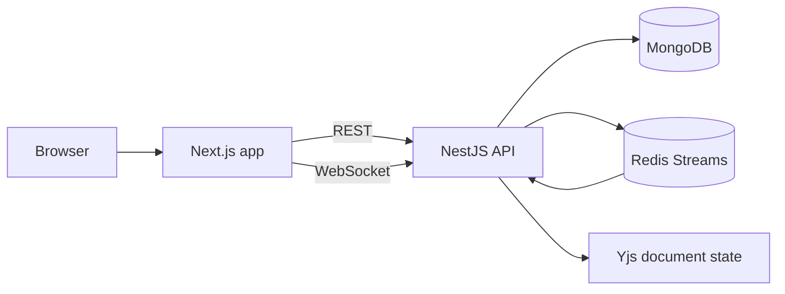
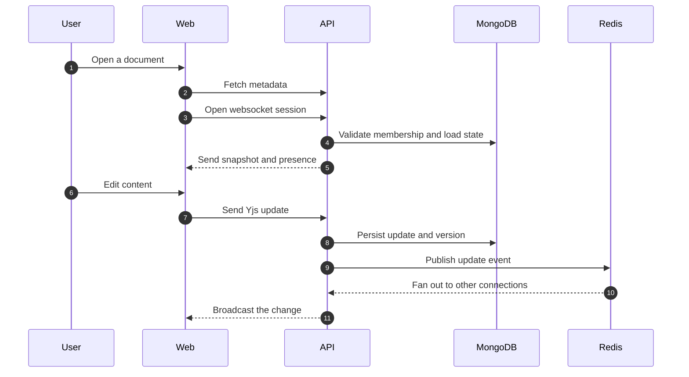

# SyncSpace

SyncSpace is a real-time collaborative workspace for teams that need live editing, reliable history, and a straightforward path from local development to production.

It combines a Next.js frontend, a NestJS API, MongoDB for persistence, Redis Streams for fanout, and Yjs for conflict-free collaboration.

## Why it exists

Collaborative tools tend to split into two awkward extremes: fast demos that fall apart under real use, or heavy systems that are painful to run and harder to trust.

SyncSpace is meant to sit in the middle. It is built to be understandable, testable, and ready for multi-user editing without hiding the hard parts.

## What’s included

- authenticated workspaces with server-enforced access control
- live document editing over websockets
- versioned history and snapshotting
- offline-safe client queuing
- shared contracts across the web app, API, and collaboration utilities
- unit, integration, and browser coverage

## How it fits together



## Collaboration flow



## Repository structure

```text
apps/
  api/        backend API and collaboration gateway
  web/        frontend application
  loadtest/   collaboration load harness
packages/
  collaboration/ CRDT helpers and sync policy
  config/         shared environment parsing
  contracts/      shared validation contracts
infrastructure/
  docker/      production Dockerfiles
```

## Running locally

### Prerequisites

- Node.js 20+
- pnpm 10+
- Docker Desktop
- MongoDB and Redis, or `docker compose`

### Start the stack

```bash
cp .env.example .env
pnpm install
docker compose up -d
pnpm dev
```

Then open the web app and API using the ports defined in `.env`.

### Useful commands

```bash
pnpm lint
pnpm typecheck
pnpm test
pnpm test:e2e
pnpm build
```

## Production notes

- The API owns authentication and membership checks.
- Collaboration updates are normalized server-side before persistence.
- Redis Streams lets multiple API instances stay in sync.
- The client keeps local edits moving even when the connection is unstable.

## Environment variables

Copy `.env.example` to `.env` and fill in the values for:

- `DATABASE_URL`
- `REDIS_URL`
- `JWT_SECRET`
- `JWT_EXPIRES_IN`
- `NEXT_PUBLIC_API_BASE_URL`

## Quality gates

The repository is set up to verify the important paths before release:

- linting
- type checking
- API service tests
- browser-level editor coverage

