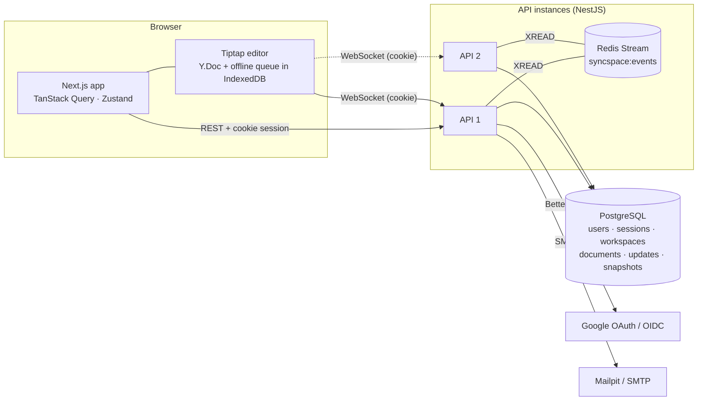
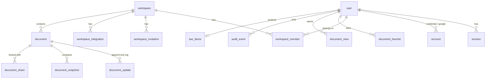

# Architecture

## Requests

- **Auth**: Better Auth is mounted on the API at `/api/auth/*`. Sessions are rows in PostgreSQL, and the browser holds
  only an `HttpOnly; SameSite=Lax` cookie. There is no cookie cache, so revoking a session takes effect on the next request.
- **Authorization**: `AccessService` + the permission matrix in `@syncspace/contracts` are the only place that decides
  what a role may do. The web app imports the same matrix to shape the UI, but the API enforces it on every route and
  on every WebSocket write. Non-members get `404`.
- **CSRF**: SameSite cookies, plus an `Origin` check on all state-changing requests. The WebSocket upgrade also checks `Origin`,
  because cookies would otherwise let any site open an authenticated socket.
- **Validation**: request bodies are parsed with the shared Zod contracts.

## Real-time path

1. Client connects to `/collaboration?documentId=…` with its session cookie. The server authenticates, checks the
   document's workspace role, **subscribes the socket**, then sends the persisted state (latest snapshot + the updates
   after it). Subscribing first means no update can be missed in between, and Yjs merges duplicates.
2. Client edits produce **incremental** Yjs updates, batched ~50 ms. Each carries a client `updateId`.
3. For every update the server: re-reads the sender's role from PostgreSQL (viewers and removed members are refused),
   validates the payload, then in one transaction increments `document.current_version` and inserts the update with
   that version. Versions are therefore server-assigned, gap-free and ordered. The `updateId` makes retries idempotent.
4. The server acks `{updateId, version}` (the UI shows **Saved** only after this), broadcasts to local sockets, and
   appends to the Redis stream.
5. **Every** API instance reads the whole stream with plain `XREAD` and forwards to its own sockets. (A shared consumer group
   would give each entry to only one instance, so peers on other instances would miss it.) Durability lives in PostgreSQL,
   so the stream is only a fan-out and can be lossy: a client that misses events resyncs on reconnect.
6. Every `SNAPSHOT_EVERY` (50) updates, a snapshot is written asynchronously. The trigger compares two integers on the
   document row. It never counts or scans the log, and loading never replays full history.

## Staying in sync when events are lost

The stream is best-effort fan-out, so every 10 seconds each instance tells the clients of every open document the latest persisted
version (`sync.check`). Versions are gap-free, so a client tracks the highest *contiguous* version it has seen and asks for the state
(`sync.request`) if it is behind on two consecutive checks. After an outage a client replays its unacknowledged backlog as one merged
update. See [failure testing](performance.md#failure-testing).

## Live access changes

Membership and session changes publish `access.changed` / `session.revoked` / `document.deleted` on the stream. Instances
close or downgrade matching sockets immediately (`4410` access removed, `4411` session revoked). A 15-second sweep
re-checks every open socket against the database as a safety net for events that never arrived.

## Presence

Identity is stamped by the server from the session, so clients cannot impersonate others. Cursor positions are opaque Yjs
relative positions relayed as-is. State is kept in a Redis hash per document with a TTL, and leaves are broadcast on disconnect.

## Offline

Unacknowledged updates are persisted to IndexedDB. On reconnect (jittered exponential backoff), the server's state is applied
first and the queue is replayed. Idempotent `updateId`s make replay safe, and CRDT merge makes concurrent edits converge.

## Data model

Schema: `apps/api/src/db/schema.ts`. Migrations: `apps/api/drizzle/`.

| Table | Purpose and key constraints |
| --- | --- |
| `user`, `session`, `account`, `verification`, `rate_limit` | Better Auth's tables. `account` holds the Argon2id password (`credential`) or a Google identity (`provider_id`+`account_id` unique). `session` is the database-backed session; deleting a row revokes it. Provider tokens are never stored. |
| `workspace` | `owner_id` FK. Soft-archived with `archived_at`. |
| `workspace_member` | `(workspace_id, user_id)` unique. Role enum `owner/editor/viewer`. Last-owner rules are enforced in a transaction that locks the owner rows. |
| `workspace_invitation` | Stores only a SHA-256 of the emailed token. Partial unique index allows one live invitation per `(workspace, email)`. |
| `document` | `current_version` is the server-assigned counter and `snapshot_version` the last compaction point. Soft-deleted with `deleted_at`. |
| `document_update` | Append-only Yjs updates (`bytea`). Unique `(document_id, version)` and `(document_id, update_id)` (the idempotency key). |
| `document_snapshot` | Compacted Yjs state at `version`. Unique per `(document_id, version)`. |
| `document_favorite`, `document_view` | Per-user favourites and recents. |
| `two_factor` | Authenticator secret and backup codes, encrypted by Better Auth. |
| `document_share` | Access to one document, addressed to an email. Unique `(document_id, email)`. `user_id` is bound once someone has verified that address, so a later email change keeps access. Unbound rows count only for a verified owner of the address. |
| `audit_event` | Security and membership events (`auth.signed_in`, `member.role_changed`, …) shown on the Security page. |

**Deleted accounts.** The person's row is removed. Documents and updates in workspaces others still use are reassigned
to a placeholder user (`deleted-user`, created by migration `0001`), so history stays intact without their name.
Workspaces with no other members are deleted.

**Why Yjs blobs live in PostgreSQL:** updates are small (typically < 1 KB), the log is bounded by snapshots, and a single
transactional store gives atomic version assignment, idempotency and consistent access control for free. A separate
blob store would add a failure mode without a measured need.

## Failure behaviour

| Failure | Behaviour |
| --- | --- |
| Browser goes offline | Status shows **Offline**. Edits keep applying locally and are queued in IndexedDB. On reconnect they replay idempotently. |
| API instance crashes (`kill -9`) or a socket drops | Client reconnects with jittered backoff (longer after a `4429`), receives fresh state, and replays its unacknowledged backlog **as one merged update**. Tested. |
| Instance frozen then resumed (GC pause, VM stall) | Its sockets are intact but it may have missed events. Same resync path as above. Tested. |
| Redis unavailable, restarted or its stream wiped | Writes still persist to PostgreSQL. Publishes queue and are delivered when Redis returns. If events were destroyed, `sync.check` (every 10 s) shows clients they are behind and they resync, typically within ~20 s. `/health` reports `redis:false` meanwhile. Tested: [failure testing](performance.md#failure-testing). |
| PostgreSQL unavailable, restarted or crashed | The API stays up. An update that can't be saved closes the socket with `1013`, so the client reconnects with backoff and resends everything unacknowledged. Nobody is reported as signed out; the web app shows **Can't reach SyncSpace** if it can't check the session. `/health` reports `postgres:false`. Tested. |
| Duplicate delivery / retries | `(document_id, update_id)` is unique, so duplicates are acked without a new version. |
| Two people edit at once | Yjs merges both. Versions are serialised by the document row lock. |
| Member removed / role changed | Event closes or downgrades sockets on every instance immediately. The 15 s sweep and the per-write role check cover missed events. |
| Session revoked | Sockets for that session close with `4411`. REST calls return `401` on the next request (no cookie cache). |
| Offline backlog larger than one message | Split into as few messages as fit. |
| A single edit too large to accept (about 1 MB) | Reported in the editor as not saved. |
| Corrupt or forged update | Rejected as `malformed` before persisting. |
| Snapshot race | Snapshots are `ON CONFLICT DO NOTHING` and `snapshot_version` only moves forward. |

Failure test results and their limits: [performance.md](performance.md#failure-testing).

## Design decisions

### Yjs for collaboration

Yjs CRDTs give convergent merging for concurrent and offline edits without operational-transform servers. The server persists and
relays opaque updates and never interprets document content.

### PostgreSQL with Drizzle

**Context.** The data is relational (users → memberships → workspaces → documents) and several invariants need transactions:
workspace + owner membership, last-owner protection, per-document version assignment, idempotent update inserts.
**Decision.** PostgreSQL as the only database; Drizzle ORM with SQL migrations. Drizzle was chosen over Prisma because it has
first-class `bytea` and `FOR UPDATE` support, produces plain reviewable SQL, has no generated client or engine binary, and is
supported by Better Auth's adapter.
**Consequences.** One datastore. MongoDB is retained only as a migration source (see [migration.md](migration.md)).

### Better Auth

**Context.** Tokens in localStorage and in WebSocket URLs, no revocation, bcrypt, no OAuth.
**Decision.** Better Auth (database sessions, HttpOnly cookies, email verification/reset, Google social login, account linking,
rate limiting) with the Drizzle adapter. It runs as an Express handler inside Nest (`toNodeHandler`, registered before the
body parser), and Nest guards call `auth.api.getSession` on every request, so there is one session system and no parallel JWT code.
Compatibility checked against Nest 11/Express 5, Node 22–26 and drizzle-orm 0.45.
**Choices.** Argon2id (OWASP parameters) via `@node-rs/argon2`. Legacy bcrypt hashes are verified and upgraded on login.
`disableImplicitLinking` so email equality never merges identities. Provider tokens are stripped by a database hook.
**Not used.** The cookie cache (it would delay revocation).

### Redis Streams with XREAD

A shared consumer group delivers each entry to a single consumer, so with multiple API instances only one would forward an
update to its sockets. Each instance now reads the full stream with `XREAD` (no group). Document durability is in PostgreSQL,
so the stream can be lossy, and reconnecting clients resync from the database. Streams are kept over pub/sub for bounded
replay and visibility (`XLEN`, `XRANGE`).
