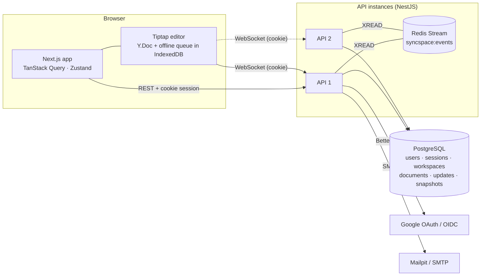

# Architecture

## Requests

- **Auth**: Better Auth is mounted on the API at `/api/auth/*`. Sessions are rows in PostgreSQL, and the browser holds
  only an `HttpOnly; SameSite=Lax` cookie. There is no cookie cache, so revoking a session takes effect on the next request.
- **Authorization**: `AccessService` + the permission matrix in `@syncspace/contracts` are the only place that decides
  what a role may do. The web app imports the same matrix to shape the UI, but the API enforces it on every route and
  on every WebSocket write. Non-members get `404`.
- **CSRF**: SameSite cookies, plus an `Origin` check on all state-changing requests. The WebSocket upgrade also checks `Origin`,
  because cookies would otherwise let any site open an authenticated socket.
- **Validation**: request bodies are parsed with the shared Zod contracts.

## Real-time path

1. Client connects to `/collaboration?documentId=…` with its session cookie. The server authenticates, checks the
   document's workspace role, **subscribes the socket**, then sends the persisted state (latest snapshot + the updates
   after it). Subscribing first means no update can be missed in between, and Yjs merges duplicates.
2. Client edits produce **incremental** Yjs updates, batched ~50 ms. Each carries a client `updateId`.
3. For every update the server: re-reads the sender's role from PostgreSQL (viewers and removed members are refused),
   validates the payload, then in one transaction increments `document.current_version` and inserts the update with
   that version. Versions are therefore server-assigned, gap-free and ordered. The `updateId` makes retries idempotent.
4. The server acks `{updateId, version}` (the UI shows **Saved** only after this), broadcasts to local sockets, and
   appends to the Redis stream.
5. **Every** API instance reads the whole stream with plain `XREAD` and forwards to its own sockets. (A shared consumer group
   would give each entry to only one instance, so peers on other instances would miss it.) Durability lives in PostgreSQL,
   so the stream is only a fan-out and can be lossy: a client that misses events resyncs on reconnect.
6. Every `SNAPSHOT_EVERY` (50) updates, a snapshot is written asynchronously. The trigger compares two integers on the
   document row. It never counts or scans the log, and loading never replays full history.

## Staying in sync when events are lost

The stream is best-effort fan-out, so every 10 seconds each instance tells the clients of every open document the latest persisted
version (`sync.check`). Versions are gap-free, so a client tracks the highest *contiguous* version it has seen and asks for the state
(`sync.request`) if it is behind on two consecutive checks. After an outage a client replays its unacknowledged backlog as one merged
update. See `docs/benchmarks/fault-injection.md`.

## Live access changes

Membership and session changes publish `access.changed` / `session.revoked` / `document.deleted` on the stream. Instances
close or downgrade matching sockets immediately (`4410` access removed, `4411` session revoked). A 15-second sweep
re-checks every open socket against the database as a safety net for events that never arrived.

## Presence

Identity is stamped by the server from the session, so clients cannot impersonate others. Cursor positions are opaque Yjs
relative positions relayed as-is. State is kept in a Redis hash per document with a TTL, and leaves are broadcast on disconnect.

## Offline

Unacknowledged updates are persisted to IndexedDB. On reconnect (jittered exponential backoff), the server's state is applied
first and the queue is replayed. Idempotent `updateId`s make replay safe, and CRDT merge makes concurrent edits converge.
