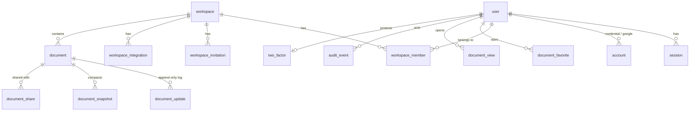

# Data model (PostgreSQL)

Schema: `apps/api/src/db/schema.ts`. Migrations: `apps/api/drizzle/`.

| Table | Purpose and key constraints |
| --- | --- |
| `user`, `session`, `account`, `verification`, `rate_limit` | Better Auth's tables. `account` holds the Argon2id password (`credential`) or a Google identity (`provider_id`+`account_id` unique). `session` is the database-backed session; deleting a row revokes it. Provider tokens are never stored. |
| `workspace` | `owner_id` FK. Soft-archived with `archived_at`. |
| `workspace_member` | `(workspace_id, user_id)` unique. Role enum `owner/editor/viewer`. Last-owner rules are enforced in a transaction that locks the owner rows. |
| `workspace_invitation` | Stores only a SHA-256 of the emailed token. Partial unique index allows one live invitation per `(workspace, email)`. |
| `document` | `current_version` is the server-assigned counter and `snapshot_version` the last compaction point. Soft-deleted with `deleted_at`. |
| `document_update` | Append-only Yjs updates (`bytea`). Unique `(document_id, version)` and `(document_id, update_id)` (the idempotency key). |
| `document_snapshot` | Compacted Yjs state at `version`. Unique per `(document_id, version)`. |
| `document_favorite`, `document_view` | Per-user favourites and recents. |
| `two_factor` | Authenticator secret and backup codes, encrypted by Better Auth. |
| `document_share` | Access to one document, addressed to an email. Unique `(document_id, email)`. `user_id` is bound once someone has verified that address, so a later email change keeps access. Unbound rows count only for a verified owner of the address. |
| `audit_event` | Security and membership events (`auth.signed_in`, `member.role_changed`, …) shown on the Security page. |

**Deleted accounts.** The person's row is removed. Documents and updates in workspaces others still use are reassigned
to a placeholder user (`deleted-user`, created by migration `0001`), so history stays intact without their name.
Workspaces with no other members are deleted.

**Why Yjs blobs live in PostgreSQL:** updates are small (typically < 1 KB), the log is bounded by snapshots, and a single
transactional store gives atomic version assignment, idempotency and consistent access control for free. A separate
blob store would add a failure mode without a measured need.
